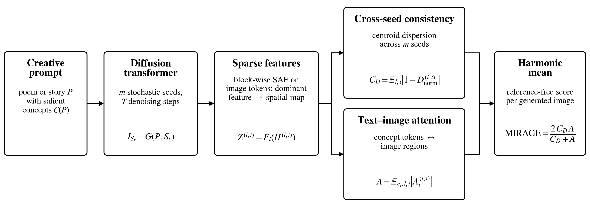

# Mechanistic-Interpretability Image Quality Metrics for Diffusion Models

Internal-mechanism-based image-quality metrics for text-to-image diffusion
models (SD3, PixArt-alpha, FLUX), built from cross-attention centroid
geometry and SAE-based concept activations, validated against public
benchmarks (CLIPScore, BLIP-2, VQAScore) and real human ratings.

## Structure

| Path | Contents |
| --- | --- |
| `src/` | Core pipeline: per-model activation extractors (`sd_activation_extractor.py`, `pixart_activation_extractor.py`, `flux_activation_extractor.py`), SAE training (`train_sae.py`, `generate_sae.py`), run/eval wrappers (`run_extract*.py`, `run_sd3.py`, `run_pixart.py`), and analysis/visualization scripts. |
| `tests/` | Validation and smoke-test scripts (manual, GPU-dependent — not a CI suite). See `tests/README.md` for what each one checks and how to run it. |
| `data/` | The canonical 600-prompt evaluation set (`prompts_600.csv`), the calibration/test splits, concept definitions, historical training-set snapshots (`training_sets/`), and analysis-ready results (`results/`) — MIRAGE validation data, the baseline comparison, the concentration ablation, SAE top-concepts, and the anonymized human ratings (`results/rics.xlsx`). See `results/README.md`. |
| `human_eval_streamlit/` | The Streamlit app used to collect human ratings (prompt/image pairs, 4-axis scoring). |
| `human_eval_app/` | An unused Next.js prototype for the same task (correctly reads the canonical prompt set, but its rating storage is local-file-only and not yet backed by a real database). |
| `imageMetric/` | Public-benchmark scoring (CLIPScore, BLIP-2, VQAScore, Inception Score) and image generation scripts, self-contained. |
| `writeups/` | The current pipeline figure (`mirage_pipeline_plain.{png,pdf,tex}`), earlier pipeline/failure-case diagrams (`.drawio`), the earlier Concept Fidelity Score (CFS) spec (`metric_spec.html`, `cfs_pipeline.html`; superseded, kept for reference), and paper drafts. |
| `sae_interpretation/` | Per-concept SAE activation visualizations by seed/timestep. |
| `flux_sae_training/`, `flux_sae_validation/` | FLUX-specific SAE training logs and validation output. |

## The metric

**MIRAGE** scores a generated image from the generator's own internals — no
reference image and no external vision-language model. For each prompt it
combines two model-internal signals with a **harmonic mean**:

```
MIRAGE = 2 * C_D * A / (C_D + A)

C_D = E_{l,t}[ 1 - D_norm(l,t) ]      cross-seed consistency
A   = E_{c_i,l,t}[ A_i(l,t) ]         text-image attention
```

- `C_D` (cross-seed consistency): the dominant SAE feature's spatial map is
  tracked at transformer block `l` and denoising step `t`; `D_norm(l,t)` is
  the normalized dispersion of its centroid across `m` random seeds, so a
  prompt whose feature lands in the same place regardless of seed scores high.
- `A` (text-image attention): a per-concept-token attention term `A_i(l,t)`
  computed from the cross-modal attention between the prompt's concept tokens
  `c_i` and the image regions, averaged over concept tokens, blocks and
  denoising steps.



Pipeline: prompt → `m` seeds of the diffusion transformer → block-wise SAE on
image tokens (dominant feature → spatial map) → the two signals → harmonic
mean. Vector version: `writeups/mirage_pipeline_plain.pdf`; TikZ source:
`writeups/mirage_pipeline_plain.tex`.

### Which numbers in this repository belong to which score

The validation data under `data/results/` (35 human-rated pairs:
`mirage_validation_n35.csv`, `baseline_comparison.csv`) was produced with an
**earlier two-feature variant** of MIRAGE built from attention-centroid
geometry only — how far the centroid moves across transformer depth (`drift`)
and across denoising time (`ts_path`):

```
raw = w0 + w_drift * drift + w_tspath * ts_path
MIRAGE_v0 = sigmoid((raw - midpoint) / temp)
```

On those 35 pairs the earlier variant correlates with human judgment at
r = 0.495 (leave-one-out r = 0.377) versus r = 0.050, -0.158, -0.039 for
CLIPScore, BLIP-2 and VQAScore on the same images. **These are not results for
the harmonic-mean score defined above**: the per-prompt extraction on the
600-prompt evaluation set stores a single seed (42), so the cross-seed term
`C_D` is not computed in the released tables. The anonymized human ratings
(`data/results/rics.xlsx`) and the guided tour of the validation data are in
`data/results/README.md`. `writeups/metric_spec.html` and
`writeups/cfs_pipeline.html` document the earlier Concept Fidelity Score (CFS)
design (geometric mean within a concept, arithmetic mean across concepts) and
are kept for reference only.

## Known limitations (tracked, not hidden)

- The shared CSV loader (`load_concept_dataset` in
  `src/sd_activation_extractor.py`) has a title-detection heuristic that
  merges one continuation row on the 600-prompt set (a lowercase poem
  title gets read as a continuation of the previous row), capping
  real coverage at 599/600 for SD3, PixArt, and FLUX-schnell.
- The earlier two-feature MIRAGE variant's weights are fit on the same 35
  rows they're validated against; leave-one-out CV gives r &asymp; 0.38, the
  honest generalization estimate for that variant.
- The released per-prompt extraction on the 600-prompt evaluation set uses a
  single seed (42); the cross-seed consistency term `C_D` therefore needs a
  multi-seed run before it can be reported on that set.
- Attention concentration (a separate entropy-based measure of how
  focused the attention map is) does **not** improve the earlier
  two-feature MIRAGE variant when added as a third term — tested seven
  ways, all negative or overfit. See
  `data/results/concentration_ablation_summary.md` for the full ablation.
